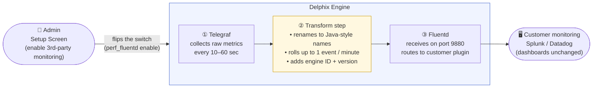

# Telegraf → Fluentd Metric Forwarding

**Jira**: [DLPX-100030](https://perforce.atlassian.net/browse/DLPX-100030) · **Status**: Pending review · **Owner**: Dhruvin Shah

---

## Problem

Delphix customers can forward engine health metrics (CPU, Disk, Network, NFS, iSCSI, TCP) to their own monitoring tools (Splunk, Datadog) through a service called **Fluentd** that already runs on every engine. Historically, Java code on the engine collected those metrics and pushed them to Fluentd.

When a Delphix Engine (DE) is added to **DCT** (Data Control Tower), DCT becomes the central collector. To avoid sending the same data twice, Java's metric collection is intentionally turned off on that engine. **The side effect: the push to Fluentd stops too.** Those customers now see zero metrics in their Splunk / Datadog dashboards even though nothing else changed in their setup.

```
DE + DCT today:   Java OFF  → Fluentd → ❌ Splunk (no data)
                  Telegraf ON → InfluxDB ✅  (local only, no path to Fluentd)
```

---

## Solution

Teach **Telegraf** (which is already running on DCT-managed engines) to send the same six metrics to Fluentd in the same shape Java used — so customers' existing Splunk / Datadog dashboards keep working with **no change on their side**.

---

## How It Flows (end-to-end)



**Step by step:**

1. **Admin turns it on once** — in the Delphix setup screen, they save Splunk / Datadog credentials. Internally, this calls `perf_fluentd enable`, which creates a flag file and restarts Telegraf. From then on, the engine forwards automatically.

2. **Telegraf collects** — Telegraf is already gathering CPU usage, network bytes, disk operations, etc. every 10–60 seconds. This step changes nothing; the data was already being collected and stored in InfluxDB.

3. **Transform** — a Starlark script inside Telegraf picks six of those raw metrics, renames them to the exact names the customer's dashboards expect (`system.cpu.util.pct`, `system.net.total.bytes`, etc.), rolls them up to one event per minute, and tags each with the engine UUID and version. This is the "backward compatibility" layer that keeps the customer's dashboards working.

4. **Send to Fluentd** — Telegraf POSTs those tidy events to Fluentd on localhost port 9880. Fluentd is already running on the engine and already has routing rules (`<match delphix.metrics.**>`) that forward anything on this channel to whichever third-party plugin the customer configured. **Those routing rules do not change.**

5. **Customer's dashboards light up** — Splunk / Datadog receive events with the same metric names, same values, and same identifying fields they always did. The customer sees no difference.

---

## What Customers Receive (same as Java)

| Field | Value |
|---|---|
| `metric_name` | one of: `system.cpu.util.pct` · `system.net.total.bytes` · `system.disk.ops.count` · `system.nfs.ops.count` · `system.iscsi.ops.count` · `system.tcp.total.bytes` |
| `_value` | numeric value for that metric |
| `systemUniqueId` | engine UUID (lets customers filter by engine in multi-engine setups) |
| `systemVersion` | engine software version |
| `event` | `"metric"` |
| **Frequency** | 1 event per metric per minute |
| **Transport** | HTTP POST → Fluentd `:9880` (replaces old Fluentd Forward on `:24224`) |

---

## What's New in the Engine (3 files)

| File | Role |
|---|---|
| `perf_fluentd` | Command-line switch: `enable` / `disable` / `status` |
| `telegraf.outputs.fluentd` | Tells Telegraf where to POST the events |
| `telegraf.processors.fluentd` | The Starlark transform (renaming + rollup) |

---

## Recommendation

| Customer segment | Today | What to do |
|---|---|---|
| **DE + DCT** | ❌ Broken — zero data reaching Splunk | **Unblock first** — this fix resolves it |
| **DE standalone** | ✅ Java still forwarding | Leave Java on until the Telegraf path is proven in the DCT segment |

The feature ships **off by default**. No existing customer is affected until the admin explicitly enables it from the setup screen.
