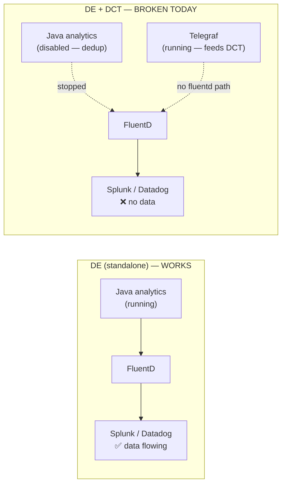
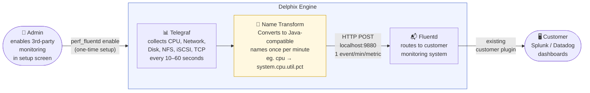
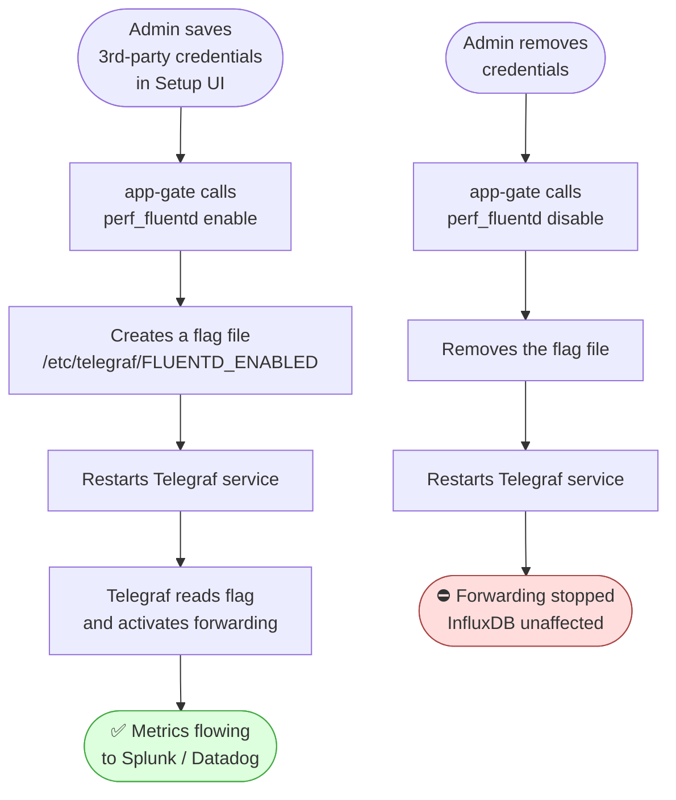
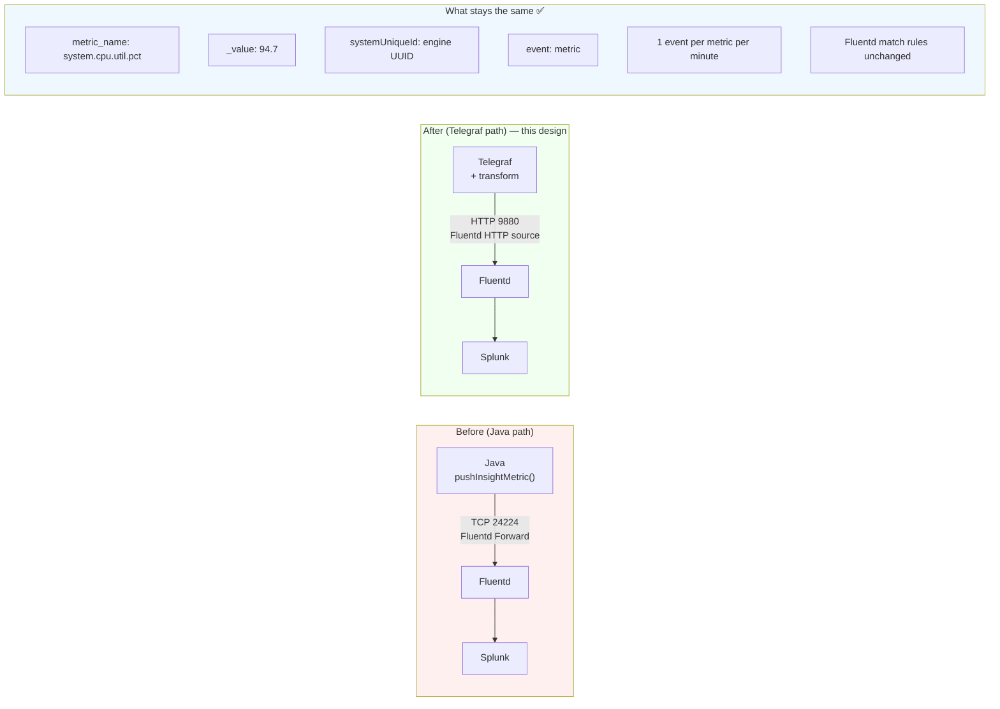
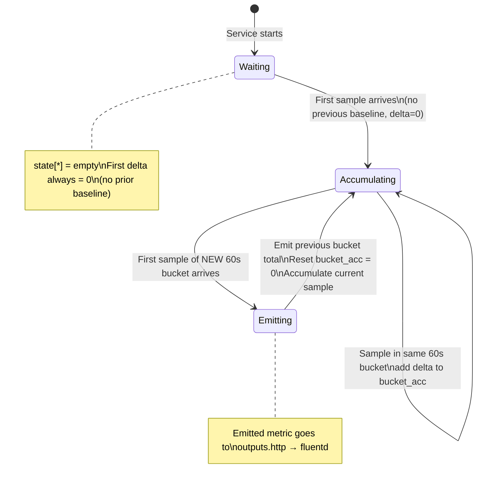
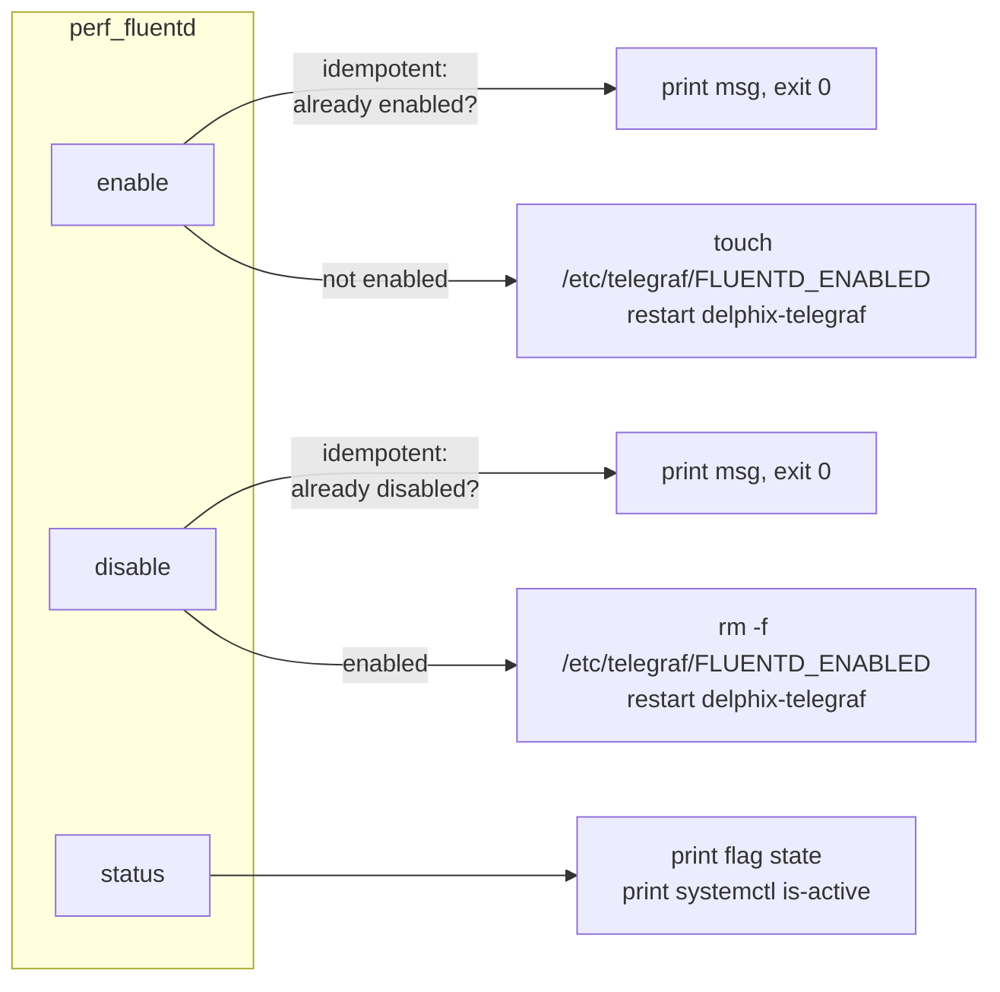
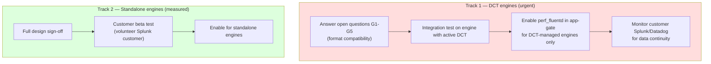
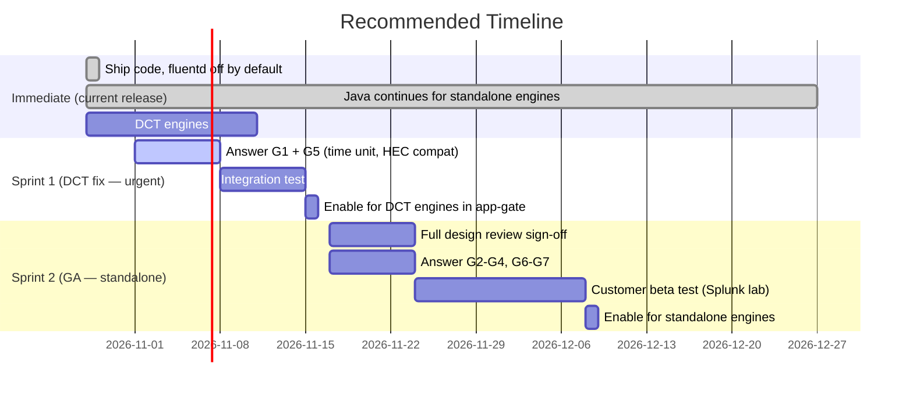

# Telegraf → Fluentd Metric Forwarding — Design Document

**Status**: Draft — pending design review  
**Jira**: [DLPX-100030](https://perforce.atlassian.net/browse/DLPX-100030)  
**Author**: Dhruvin Shah  
**Reviewers**: Seb Roy (architecture), TBD

---

## 1. Executive Summary

Delphix engines can forward performance metrics to customer-managed monitoring systems (Splunk, Datadog, Elasticsearch) via a Fluentd HTTP routing layer. This path was previously implemented in Java (`pushInsightMetric`).

**Critical context:** When a Delphix Engine (DE) is added to DCT, Java performance collection is intentionally disabled on the engine to avoid data duplication (DCT becomes the collector). This means **customers who add their engine to DCT and rely on Splunk/Datadog forwarding immediately lose all metric data** — the Java path stops and there is currently no replacement. The Telegraf → Fluentd path is therefore not a refactor; it is a bug fix for an existing regression.

This document covers the High-Level Design (HLD) and Low-Level Design (LLD) for the Telegraf-based replacement, the risks, the stop-gap position, and the acceptance criteria for a production release.

---

## 2. Background — Why This Matters

### 2.1 The Problem: DCT Breaks Third-Party Metric Forwarding

When a DE is registered with DCT, the engine's Java analytics collection (`AnalyticsStorageImpl`, `LocalCpuCollector`, etc.) is disabled. This is intentional — DCT takes over and deduplicates the data. **However, `pushInsightMetric` — which forwards metrics to customer Splunk/Datadog — is also stopped as a side effect.**



**Impact**: Any customer who has:
1. Enabled third-party metric forwarding (Splunk/Datadog), AND
2. Registered their engine with DCT

is currently receiving zero metric data in their monitoring system. This is a silent regression — Telegraf runs fine but has no path to Fluentd.

### 2.2 Why Replace It — The Real Driver Is DCT

The primary motivation is **not** decommissioning Java for its own sake. It is:

> When a DE is added to DCT, Java performance collection is intentionally stopped to prevent duplicate data. As a side effect, third-party metric forwarding (`pushInsightMetric`) also stops. Telegraf is already running on DCT-managed engines and is the only active collector — so Telegraf must take over the Fluentd forwarding role or those customers lose their Splunk/Datadog metrics entirely.

Secondary benefits (valid, but not the driver):
- One collection stack instead of two (lower maintenance)
- Richer granularity in InfluxDB from Telegraf
- Pluggable output architecture

### 2.3 The Current (Java) Path — Standalone Engines Only

For engines NOT registered with DCT, the Java path still works. Customers receive one metric event per minute for six engine-level KPIs:

```
Java (AnalyticsStorageImpl)
    │
    │  pushInsightMetric() — once per minute per metric
    │  format: flat JSON over FluentD Forward Protocol (TCP 24224)
    ▼
FluentD (on engine)
    │
    │  <match delphix.metrics.**>
    │  routes to customer plugin
    ▼
Customer Monitoring System (Splunk, Datadog, etc.)
```

**Event shape Java sends:**

```json
{
  "metric_name": "system.cpu.util.pct",
  "_value": 80.4,
  "_time": 1642520280000,
  "event": "metric",
  "type": "g",
  "systemUniqueId": "564dec8e-f543-1aeb-7563-ee08901877c5",
  "systemVersion": "6.0.1.0",
  "data": { "user": 360, "kernel": 630, "idle": 118220 }
}
```

**The six Java metrics:**

| metric_name | Meaning | Unit |
|---|---|---|
| `system.cpu.util.pct` | CPU busy % in last minute | gauge, % |
| `system.net.total.bytes` | Network bytes (in+out) in last minute | counter, bytes |
| `system.disk.ops.count` | Disk ops (read+write) in last minute | counter, ops |
| `system.nfs.ops.count` | NFS ops (read+write) in last minute | counter, ops |
| `system.iscsi.ops.count` | iSCSI ops (read+write) in last minute | counter, ops |
| `system.tcp.total.bytes` | TCP bytes (in+out) in last minute | counter, bytes |

### 2.2 Why Replace It

Java's collection stack (`AnalyticsStorageImpl`, `LocalCpuCollector`, etc.) is being decommissioned as Telegraf becomes the single source of truth for engine metrics. The Telegraf path offers:
- Lower maintenance cost (one collection stack, not two)
- Richer metric granularity in InfluxDB
- Pluggable output architecture

---

## 3. High-Level Design (HLD)

### 3.1 What It Does in One Picture



**In plain English:**
1. Admin enables forwarding once in the Delphix setup screen.
2. Telegraf (already running) collects engine health metrics every few seconds.
3. A transform step (built into Telegraf) reshapes those metrics to match the exact format customers' Splunk/Datadog dashboards expect — one tidy event per metric per minute.
4. Fluentd (already running) receives the events and routes them to the customer's monitoring system using their existing plugin config. Nothing changes on the customer side.

---

### 3.2 How the On/Off Switch Works

The customer can turn forwarding on or off from the Delphix setup screen at any time.



**Key point:** The flag file is the single source of truth. If it exists → forwarding is on. If it doesn't → forwarding is off. Telegraf reads this on every restart and builds its config accordingly.

---

### 3.3 What Stays the Same for Customers

Customers do **not** change anything in their monitoring system. The event format, metric names, and Fluentd routing rules are preserved from the old Java implementation:



---

## 4. Low-Level Design (LLD)

### 4.1 Files Shipped by This Feature

| File | Installed path | Purpose |
|---|---|---|
| `telegraf/perf_fluentd` | `/usr/bin/perf_fluentd` | Enable / disable / status CLI |
| `telegraf/telegraf.outputs.fluentd` | `/etc/telegraf/telegraf.outputs.fluentd` | HTTP output stanza (static) |
| `telegraf/telegraf.processors.fluentd` | `/etc/telegraf/telegraf.processors.fluentd` | Starlark metric transform |
| `telegraf/delphix-telegraf-service` | `/usr/bin/delphix-telegraf-service` | Modified: fluentd awareness |

### 4.2 Metric Transform Pipeline (Starlark Processor)

The starlark processor handles two classes of metrics differently:

#### Class A — Gauge (instantaneous value)

Only `system.cpu.util.pct`. Java computed `(user + kernel) / (user + kernel + idle) * 100` using delta jiffies over the sampling interval. Telegraf's `inputs.cpu` `usage_idle` field is already this ratio. We just invert it.

```
cpu (usage_idle = 5.3%)
    └─ system.cpu.util.pct = 100 - 5.3 = 94.7%
```

Bucketing: keep the last sample in each 60s window and emit once at bucket transition.

#### Class B — Counter (delta over the minute)

Java polled `/proc/net/dev`, `/proc/diskstats`, etc. and sent `current - previous`. Telegraf exposes the same data as cumulative counters. We compute the delta in starlark using persistent state.

```
net (bytes_recv=1000, bytes_sent=500)    ← cumulative since boot
    prev bytes_recv=800, bytes_sent=350   ← stored in state
    delta = (1000-800) + (500-350) = 350 bytes
    └─ system.net.total.bytes += 350       ← add to 60s bucket
```

At bucket boundary: emit the accumulated bucket total, reset to 0.

#### Class C — Rate-based counter (estat)

`estat nfs/iscsi` output `iops(/s)` — the average rate over the 10s collection window. To get ops-in-window: `iops * 10`. Two rows per window (name=read, name=write), both accumulated.

```
estat_nfs (iops(/s)=50, name=read)   → ops in 10s = 500
estat_nfs (iops(/s)=30, name=write)  → ops in 10s = 300
    accumulated into 60s bucket
    └─ system.nfs.ops.count = 800 total ops this minute
```

#### Bucket state machine (all counter types)



### 4.3 Event Format (LLD — what actually flows over the wire)

Telegraf serialises using `splunkmetric_hec_routing = true`. For each field in each compat measurement, it emits one JSON object in Splunk HEC metrics format:

**Wire format (HTTP POST body — newline-delimited HEC events):**

```json
{"time":1793166060,"event":"metric","host":"ip-10-110-245-219","fields":{"metric_name":"system.cpu.util.pct","_value":94.7,"systemUniqueId":"564dec8e-...","systemVersion":"6.0.1.0"}}
{"time":1793166060,"event":"metric","host":"ip-10-110-245-219","fields":{"metric_name":"system.net.total.bytes","_value":350000,"systemUniqueId":"564dec8e-...","systemVersion":"6.0.1.0"}}
...
```

**Field-by-field comparison with Java:**

| Field | Java | Telegraf (this design) | Compatible? |
|---|---|---|---|
| `metric_name` | `system.cpu.util.pct` | `system.cpu.util.pct` | ✅ exact match |
| `_value` | numeric | numeric (delta-based, same semantics) | ✅ |
| `_time` / `time` | milliseconds epoch | seconds epoch (HEC standard) | ⚠️ unit differs |
| `event` | `"metric"` | `"metric"` | ✅ exact match |
| `systemUniqueId` | engine UUID | engine UUID (via `get-system-uuid`) | ✅ exact match |
| `systemVersion` | `"6.0.1.0"` | full build string | ⚠️ format differs |
| `type` | `"g"` / `"c"` | absent | ⚠️ missing |
| `data` | `{"user":360, ...}` | absent | ❌ not replicated |
| Structure | flat JSON object | HEC nested `{"fields":{...}}` | ⚠️ needs `data_type metric` in fluent-plugin-splunk-hec |

**Open items requiring design approval:**
1. `_time` unit — does fluent-plugin-splunk-hec accept seconds? Does Splunk mstats tolerate it?
2. `systemVersion` format — full build string vs. short version (`6.0.1.0`)?
3. `type` field — needed by any customer plugin?
4. `data` sub-object — any customer dashboard queries it?
5. Nested HEC structure — does the companion app-gate change (PR #5043) handle this?

### 4.4 Identity Tag Injection

`systemUniqueId` and `systemVersion` are set per compat metric inside the starlark source at config-generation time via `envsubst`. This scopes them to fluentd-bound metrics only (InfluxDB cardinality is unaffected).

```
delphix-telegraf-service
    ├── reads env: DELPHIX_SYSTEM_UUID=$(get-system-uuid)
    ├── reads env: DELPHIX_SYSTEM_VERSION=$(get-appliance-version)
    └── envsubst '${DELPHIX_SYSTEM_UUID} ${DELPHIX_SYSTEM_VERSION}' \
            < telegraf.processors.fluentd >> telegraf.conf
```

### 4.5 Enable / Disable Control



---

## 5. Known Gaps and Open Questions

These must be answered before this feature is promoted to GA:

| # | Question | Owner | Impact |
|---|---|---|---|
| G1 | Does `_time` in seconds (vs Java's milliseconds) break Splunk mstats queries or Datadog ingest? | Seb | High — dashboard breakage |
| G2 | Does `systemVersion` as a full build string break customer dashboard filters? | Seb | Medium |
| G3 | Do any customer Splunk dashboards query the `data` sub-object (raw jiffy/bytes breakdown)? | Seb | Medium |
| G4 | Does `type: "g"/"c"` matter to any downstream plugin? | Seb | Low |
| G5 | Does the HEC nested structure (`fields: {...}`) work with existing customer `fluent-plugin-splunk-hec` configs without `data_type metric`? | Seb | High |
| G6 | Are `system.tcp.total.bytes` values from connstat semantically equivalent to what Java's `LocalTCPStatsCollector` sent? (cumulative per-connection vs delta per-endpoint) | Engineering | Medium |
| G7 | What is the validation plan for NFS/iSCSI metrics on an engine with active NFS/iSCSI traffic? | Engineering | High |

---

## 6. Stop-Gap Position and Urgency

### 6.1 Two Customer Segments, Different Urgency

| Segment | Java path state | Impact today | Stop-gap available? |
|---|---|---|---|
| **DE standalone** (no DCT) | Running ✅ | No impact | Yes — Java continues |
| **DE + DCT** | Disabled ❌ | **Already broken** — zero metrics reaching Splunk/Datadog | **No stop-gap** — needs this fix |

The "keep Java running in parallel" stop-gap only works for standalone engines. For DCT-managed engines, this PR **is** the stop-gap. Those customers are already getting zero data.

### 6.2 Two-Track Approach



### 6.3 Recommended Stop-Gap Actions (Current Release)

1. **Ship this code** — it is off by default and does not interfere with the Java path.
2. **DCT engines**: Prioritise answering G1 (time unit), G5 (HEC structure compatibility) — these are the only blockers for the DCT use case. Target: 1 sprint.
3. **Standalone engines**: Keep Java path active. Do NOT call `perf_fluentd enable` in app-gate for standalone engines until the full design is reviewed and tested.
4. **App-gate companion (PR #5043)**: Gated behind design review — do not merge until open questions are answered.



---

## 7. Testing Plan (for GA)

| Test | What it verifies |
|---|---|
| `perf_fluentd enable` on a clean engine | Flag created, service restarts, fluentd stanza present in conf |
| `perf_fluentd disable` | Flag removed, stanza absent, InfluxDB output unaffected |
| Both InfluxDB + fluentd enabled | Both outputs in conf, storage_io inputs present, no discard |
| Neither enabled | `[[outputs.discard]]` in conf, Telegraf starts without error |
| Partial package (processor missing) | `logger` ERROR logged, service starts with raw names (documented fallback) |
| CPU metric value vs Java baseline | `system.cpu.util.pct` within ±1% of Java value at same point in time |
| Net/disk/tcp delta correctness | Download 100 MB, verify `system.net.total.bytes` ≈ 100 MB in that minute |
| NFS/iSCSI ops on active NFS mount | `system.nfs.ops.count` > 0 when NFS traffic active |
| Splunk end-to-end (lab) | Events appear in Splunk with correct `metric_name`, queryable via mstats |
| Datadog end-to-end (lab) | Events appear in Datadog metrics explorer |
| Service restart data gap | Restart Telegraf mid-minute; confirm at most one event missing |
| Concurrent enable/disable | Rapid enable/disable in loop; conf always valid, no half-written file |

---

## 8. Risks

| Risk | Likelihood | Impact | Mitigation |
|---|---|---|---|
| `_time` unit mismatch breaks Splunk mstats | Medium | High | Test in Splunk lab before GA; add explicit ms conversion if needed |
| `systemVersion` format breaks dashboard filters | Low | Medium | Strip to short form (e.g. `6.0.1.0`) at envsubst time |
| connstat instability causes `system.tcp.total.bytes` gaps | Medium | Low | Metric was absent in some Java releases too; acceptable |
| Starlark bucket logic has timing edge case at restart | Low | Low | At most one 60s gap; existing Java path also had restart gaps |
| InfluxDB receives `system.*` measurements (no namedrop) | High | Low | Extra series but no correctness impact; add namedrop in follow-up |
| NFS/iSCSI `iops(/s) * 10` breaks if estat interval changes | Low | Medium | Document coupling; add assertion in CI |

---

## 9. Appendix — File Inventory

```
performance-diagnostics/
├── telegraf/
│   ├── perf_fluentd                  ← NEW: enable|disable|status CLI
│   ├── telegraf.outputs.fluentd      ← NEW: HTTP output stanza
│   ├── telegraf.processors.fluentd   ← NEW: starlark transform
│   └── delphix-telegraf-service      ← MODIFIED: fluentd awareness
└── debian/
    └── rules                         ← MODIFIED: installs perf_fluentd
```

**Companion app-gate change (separate PR):**
```
dlpx-app-gate/
└── appliance/src/.../fluent.conf.stg  ← adds <source @type http port 9880>
                                          and data_type metric in <match>
```
