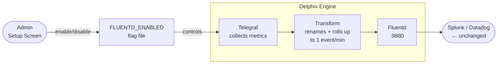

# Telegraf → Fluentd Metric Forwarding

**Jira**: [DLPX-100030](https://perforce.atlassian.net/browse/DLPX-100030) · **Status**: Pending review · **Owner**: Dhruvin Shah

---

## Problem

When a DE is added to DCT, Java analytics is disabled to avoid duplication. This silently stops metric forwarding to customer Splunk / Datadog — they receive nothing.

```
DE + DCT today:  Java OFF → Fluentd → ❌ Splunk (no data)
                 Telegraf ON → InfluxDB ✅ (but no Fluentd path)
```

---

## Solution

Add a Fluentd output path to Telegraf so DCT-managed engines resume forwarding metrics to customer monitoring systems with **no changes on the customer side**.

---

## Data Flow



---

## What Customers Receive (unchanged from Java)

| Field | Value |
|---|---|
| `metric_name` | `system.cpu.util.pct`, `system.net.total.bytes`, `system.disk.ops.count`, `system.nfs.ops.count`, `system.iscsi.ops.count`, `system.tcp.total.bytes` |
| `_value` | Numeric value for that metric |
| `systemUniqueId` | Engine UUID |
| `systemVersion` | Engine version |
| `event` | `"metric"` |
| Frequency | 1 event per metric per minute |
| Protocol | HTTP POST → Fluentd :9880 (was TCP :24224) |

---

## What's New (3 files)

| File | What it does |
|---|---|
| `perf_fluentd` | CLI: `enable` / `disable` / `status` |
| `telegraf.outputs.fluentd` | HTTP output config (static) |
| `telegraf.processors.fluentd` | Starlark: rename metrics + compute 60s deltas |

---

## Open Questions — Need Answers Before GA

| # | Question | Who | Risk |
|---|---|---|---|
| Q1 | Does `_time` in **seconds** (not ms like Java) break Splunk mstats? | Seb | High |
| Q2 | Does the HEC nested structure `{"fields":{...}}` work with existing customer Fluentd plugins? | Seb | High |
| Q3 | Does `systemVersion` as a full build string break any dashboard filter? | Seb | Medium |
| Q4 | Is `system.tcp.total.bytes` from connstat semantically equivalent to Java's value? | Eng | Medium |
| Q5 | Can we test NFS/iSCSI metrics on an engine with active traffic before GA? | Eng | Medium |

---

## Recommendation

| Segment | Today | Action |
|---|---|---|
| **DE + DCT** | ❌ Broken — no data in Splunk | Unblock: answer Q1 + Q2 this sprint, enable |
| **DE standalone** | ✅ Java still working | Hold: keep Java, enable Telegraf path only after Q1–Q5 answered |

The feature is **off by default**. Existing customers are unaffected until explicitly enabled.
