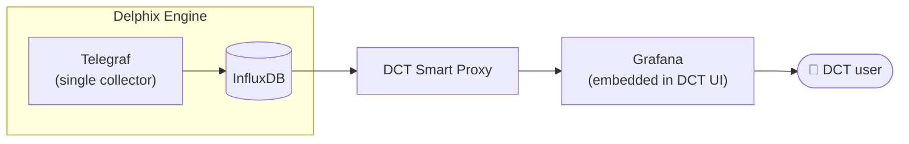
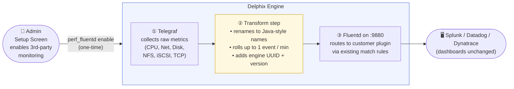
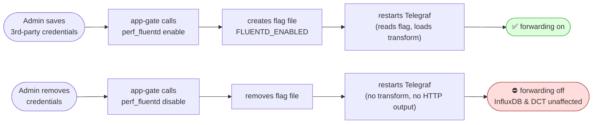

# Telegraf → Fluentd Metric Forwarding (Backward-Compat for DCT-Managed Engines)

**Jira**: [DLPX-100030](https://perforce.atlassian.net/browse/DLPX-100030) ·
**Related design**: [Delphix Engine Performance Analytics in DCT](https://perforce.atlassian.net/wiki/spaces/DLXEN/pages/2740027450) ·
**Discussion**: [Slack thread with Seb Roy](https://perforce.slack.com/archives/C09JVAKD3JM/p1793111848235599)

**Reference PRs** (sample implementation for review alongside this doc):

| PR | Repo | What it does |
|---|---|---|
| [#135](https://github.com/delphix/performance-diagnostics/pull/135) | `performance-diagnostics` | Telegraf HTTP output, Starlark transform (name mapping + delta rollup), engine identity injection, `perf_fluentd` CLI |
| [#5043](https://github.com/delphix/dlpx-app-gate/pull/5043) | `dlpx-app-gate` | Removes the Java `pushInsightMetric` path, adds `<source @type http port 9880>` to `fluent.conf.stg`, wires `perf_fluentd enable/disable` into the Fluentd lifecycle (`FluentServiceImpl`) |

---

## 1 · Context — What We're Building

A broader initiative — *Delphix Engine Performance Analytics in DCT* — is moving engine-level performance monitoring **into DCT**. In this new architecture:

- A single **Telegraf** process on each Delphix Engine (DE) is the one and only metric collector.
- Telegraf writes to a **local InfluxDB** on the DE.
- DCT UI embeds Grafana dashboards (via a Smart Proxy) that query that InfluxDB for the selected engine.



**Side effect of making Telegraf the single collector:** when a DE is added to DCT, the engine's old Java analytics stack (`AnalyticsStorageImpl`, `pushInsightMetric`, etc.) is **intentionally disabled** to avoid duplicate data in InfluxDB and the DCT path.

---

## 2 · The Problem We're Solving Here

The Java stack that we switch off also happened to be the path by which engines forwarded six KPI metrics to **customer-owned monitoring tools** (Splunk, Datadog, Dynatrace) via a local **Fluentd** service.

```
Standalone DE today :  Java ON  → Fluentd → ✅ Splunk / Datadog (works)
DE + DCT today      :  Java OFF → Fluentd → ❌ nothing (silently broken)
```

Customers who use third-party monitoring and move their engine to DCT **lose that integration**. There is no replacement unless we build one.

This document covers **only that gap** — the Telegraf → Fluentd forwarding path.

---

## 3 · What We Have vs What We Need

| | Standalone DE (today) | DCT-managed DE (today) | DCT-managed DE (after this change) |
|---|---|---|---|
| Local Telegraf | ✅ running | ✅ running | ✅ running |
| InfluxDB | ✅ | ✅ | ✅ |
| DCT dashboards | n/a | ✅ (via Smart Proxy) | ✅ (unchanged) |
| **Java → Fluentd** | ✅ working | ❌ **disabled** | ❌ disabled (intentional) |
| **Telegraf → Fluentd** | — | — | ✅ **this feature** |
| Splunk / Datadog receiving data | ✅ | ❌ | ✅ |

---

## 4 · How The New Path Works (end-to-end)



**Step by step for a reader unfamiliar with the stack:**

1. **Admin flips the switch once.** In the Delphix setup screen, the admin saves their Splunk / Datadog credentials. Behind the scenes, this calls a small shell script `perf_fluentd enable` that creates a flag file and restarts Telegraf.

2. **Telegraf keeps collecting as it already does.** It gathers CPU usage, network bytes, disk I/O, etc. every 10–60 seconds and writes to local InfluxDB. **No change to that behaviour.** The data for DCT Grafana dashboards continues flowing exactly as before.

3. **A small transform runs inside Telegraf** (only when the flag file exists). It picks the six KPIs that Java used to send, renames them to the exact names existing customer dashboards expect (`system.cpu.util.pct`, `system.net.total.bytes`, …), rolls them up to one event per minute, and tags each with the engine UUID and version so customers can filter by engine in multi-engine Splunk setups.

4. **Telegraf POSTs those tidy events to Fluentd** on `localhost:9880` (HTTP). Fluentd is already running and already has a `<match delphix.metrics.**>` rule that routes to the customer's chosen plugin — Splunk HEC, Datadog, or Dynatrace. **Those routing rules do not change.**

5. **Customer dashboards light up again** with the same metric names, same values, same identifying fields they had before DCT.

---

## 5 · Backward Compatibility — What Customers See

To preserve existing Splunk searches, Datadog dashboards and Dynatrace alerts, we match the Java event shape **almost exactly** (see [Slack thread](https://perforce.slack.com/archives/C09JVAKD3JM/p1793111848235599) for the detailed negotiation with Seb):

| Field | Java (old) | Telegraf (new) | Compatible? |
|---|---|---|---|
| `metric_name` | `system.cpu.util.pct` etc. | **same** (renamed in transform) | ✅ |
| `_value` | numeric | **same** (semantic value preserved) | ✅ |
| `_time` | epoch | epoch | ✅ |
| `event` | `"metric"` | `"metric"` | ✅ |
| `systemUniqueId` | engine UUID | engine UUID (via `get-system-uuid`) | ✅ |
| `systemVersion` | engine version | engine version (via `get-appliance-version`) | ✅ |
| Frequency | 1 / min / metric | 1 / min / metric | ✅ |
| **`data` sub-counters** | `{idle, user, kernel}` | **not sent** — Telegraf doesn't expose raw kstat values | ❌ |

**The one compromise:** customers who built Splunk searches on the `data.idle` / `data.user` / `data.kernel` sub-fields lose those. Everything else survives the migration unchanged.

### Customer migration cost by segment

| Segment | What they must do |
|---|---|
| **Splunk HEC users** | Nothing — the companion template change ([app-gate PR #5043](https://github.com/delphix/dlpx-app-gate/pull/5043)) ships the new `<source @type http port 9880>` block in the standard `fluent.conf.stg` automatically |
| **Datadog users** (×2 known) | Add a 5-line `<source @type http port 9880>` stanza to their custom Fluentd template |
| **Dynatrace user** (×1 known) | Same as Datadog — 5-line stanza |

---

## 6 · User Controls

The forwarding is **off by default**. The admin controls it from the Delphix setup screen; nothing happens on a customer engine until they opt in.



The flag file (`/etc/telegraf/FLUENTD_ENABLED`) is the single source of truth. `perf_fluentd status` reports its state.

---

## 7 · What's New in the Engine (3 small files)

| File | Role |
|---|---|
| `perf_fluentd` | Shell CLI: `enable` / `disable` / `status` |
| `telegraf.outputs.fluentd` | Tells Telegraf where to POST (localhost:9880, splunkmetric format, 60 s flush) |
| `telegraf.processors.fluentd` | Starlark script that renames metrics, computes deltas, rolls up to 1 event / min, adds engine identity |

Existing `delphix-telegraf-service` is modified to include these files when the flag is set.

---

## 8 · Recommendation

| Segment | Status today | Action |
|---|---|---|
| **DE + DCT** | Silently broken — zero data in Splunk / Datadog | **Enable this path** — it is the only way to restore their integration |
| **Standalone DE** | Java still forwarding — unaffected | Keep Java on; enable the Telegraf path only once it's proven in the DCT segment |

Shipping this feature does not affect any customer who doesn't flip the switch. For DCT-managed engines where the integration is already broken, this is the restore mechanism.
